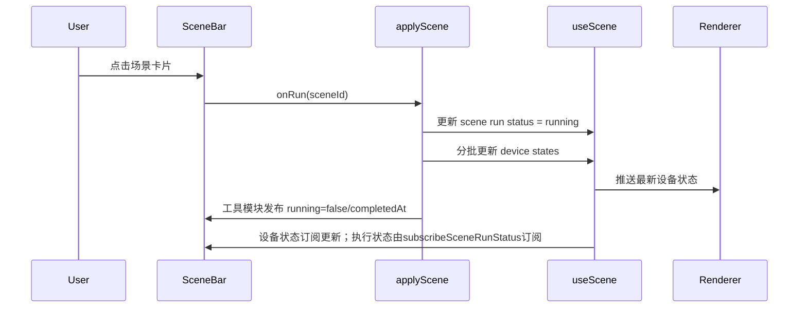
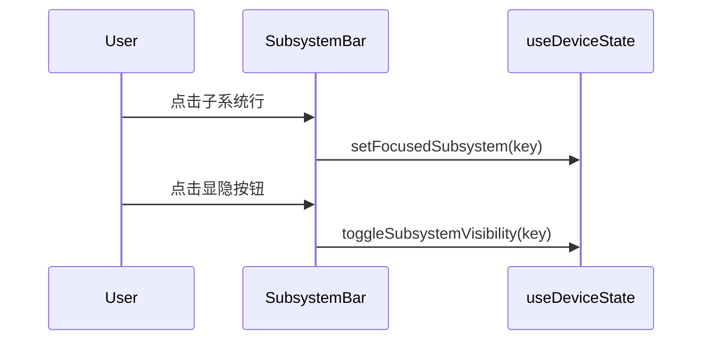
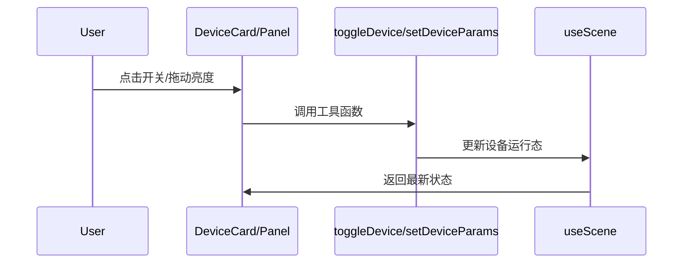

# VilHil Studio 状态流与事件流

## 1. 核心单向流

```text
User Action
  -> UI Event
  -> Tool Function
  -> useScene / useDeviceState
  -> Renderer/UI Repaint
```

规则：
1. 不允许组件之间隐式互改状态。
2. 关键业务动作必须有可观测状态。

## 2. 场景执行流（展示模式）



## 3. 子系统交互流



规则：
1. 聚焦与显隐分离。
2. 单次点击不触发双语义动作。

## 4. 设备交互流



## 5. 楼层过滤流

```text
Current Level Changed
  -> Scene/Device list recompute by levelId
  -> Proposal/UI panels re-render same scope
  -> Viewer keeps visual scope aligned
```

规则：
1. 禁止画布是 A 楼层而面板显示 B 楼层数据。

## 6. 渲染模式分层 — DeviceRenderMode Context

```text
DeviceRenderModeProvider（mode='base' | 'demo'）
  └─ DeviceRenderer
       ├─ DeviceGeometry（始终渲染，base + demo 共有）
       ├─ DeviceLight（始终渲染）
       └─ DeviceEffects（仅 mode='demo' 时渲染）
            └─ animations/*（13 个独立 effect 文件）
```

规则：
1. `DeviceRenderMode` 是纯 UI 渲染层开关，与 `useScene` / `useDeviceState` 数据流正交。
2. 编辑器后台（`mode='base'`）：无动画、无粒子，保持轻量快速。
3. 演示页（`mode='demo'`）：叠加全部 9 子系统动态效果。
4. 渲染模式变化不触发设备状态变化，两者独立。

Provider 入口：`apps/editor/app/proposal-demo/page.tsx`（`<DeviceRenderModeProvider mode="demo">`）。

## 7. 变更记录

- 2026-04-23: 补充 DeviceRenderMode 渲染模式分层说明。
- 2026-04-17: 新增状态流文档，统一场景/子系统/设备/楼层事件流。

## 2026-10-06：纱帘视觉原型边界

`/curtain-lab` 是开发环境独立渲染样本：控件 → 本页目标开合参数 → 帧内可变几何 → 状态文字。它没有业务 DeviceNode，不访问项目存储；局部参数不构成设备运行态的第二份真值。将来接入真实设备仍必须遵循 UI → smarthome tool → useScene → render；此次不重做旧隔离补丁中的场景联动。

## 2026-10-06：对开纱帘接入既有设备状态

`setDeviceState / applyScene → useScene.nodes[id].state → DeviceRenderer → CurtainContainer → SideOpenCurtain / SideOpenCurtainBoth → smarthome/curtain`。未改 schema、场景工具、持久化、设备 UI 或 `useDeviceState`。

- 单层仍用 `layerPositions[0] ?? position ?? 50`；双层仍按现有约定使用第 0 层布帘、第 1 层纱帘（后者缺省 50），不重解释历史数据的层材质顺序。
- Store 保存目标值；渲染器的 position/velocity 仅是帧间插值缓存，不反写 Store。目标变化从当前形状继续，首次挂载或重新挂载从已保存值开始。原位 `setScene` 恢复通过同一订阅更新目标。
- 隐藏祖先时停止新纱帘网格更新，重新可见时同步当前目标，避免播放隐藏期间的旧动作。静止时停更顶点；每次开合不创建新网格。
- `/curtain-lab` 继续作为冻结的独立视觉参考。集成夹具复用真实组件、Schema、Store 和工具，但不代表完整 Studio UI/Bloom/项目加载验收。带 duration 的历史场景 Tween 问题未在本次修复。


## 2026-10-03 场景与放置补充

场景执行状态为工具模块的SceneRunStatus（sceneId/running/时间戳），并非useScene内的枚举。
Tween使用独立Group；有效新执行取消旧延时、旧Tween和RAF。从当前useScene值开始过渡，
同设备后续步骤中断前一过渡。数值完成时精确写入目标，on=false与数值渐变同时配置时在完成后写入。
缺失窗帘position采用CurtainContainer已有默认50。被删除设备不重新创建。

放置：指针→既有吸附→checkDevicePlacement→绿/红预览→提交时再次校验→placeDevice→useScene。
二维所有创建入口捕获DevicePlacementError并显示提示；三维禁用非法提交。
碰撞结果是派生值，不新增schema字段、不写UI偏好到设备运行态。


2026-10-03 碰撞编辑：DevicePanel 高度/朝向及二维相机跟随调用 smarthome.updateDevicePlacement；二维设备拖动使用同一 checkDevicePlacementEdit，在实际祖先楼层中排除自身，再对目录实体 OBB 校验。拒绝时零写入、提示最后合法值；SliderControl 可接收 false 回执以回退编辑中箭头值。逐帧拖动历史保持原行为，未暂停全局历史以免漏记同时执行的场景数值过渡。


## 2026-10-06 窗帘坐标整合

`window/wall/node` 派生楼层锚点 → `curtainLocalTransform` 乘设备变换逆矩阵 →
`DeviceRenderer` 应用设备变换 → 楼层祖先应用自身变换。仅派生渲染值，无新增持久化字段。

v3 独立 Tween Group 已接入；纱帘仍读原 `useScene`，不另建业务状态。当前完整页面验收与导航阻塞见 `STUDIO-INTEGRATION-2026-10-06.md`。


## 2026-10-06 窗帘正常详情入口

当前楼层 CurtainOverlay 放大镜 → `enterDeviceDetail`（与既有 device:click 共用）→
`playTo` → `CameraRig` / 原 view 状态 → 挂载 DeviceRenderer。
胶囊主体和详情浮卡仍经既有 `setDeviceState → useScene` 控制开合。
相机输入只在原灯光集合中附加当前楼层窗帘，不扩展其他子系统行为。
窗户中心、尺寸、朝向由 `curtainViewTarget` 派生；没有新的业务 store、协议或持久化字段。

## 2026-10-06 暖通正常详情与共享选区

当前楼层暖通入口 → 原 `enterDeviceDetail → playTo → CameraRig` → 当前设备的既有 `DeviceInfoCard`。
控件仍走 `setDeviceState → useScene → DeviceEffects`。相机集合只进一步附加当前楼层 HVAC，摄像机等其余子系统未扩张。
HVAC mode=off 同时写 on=false；电源重新开启时，off 模式恢复为 cold，原 hot/cold 电源关闭再开仍保留模式。
流线、云雾与粒子的淡出只在 useFrame 中改变 Three 对象，不写 React/业务状态；父级旋转只应用一次。
BloomSelect 使用已有 Selection context 的稳定 setter 注册发光 mesh，不依赖它自己更新的 selected 数组；无第二套选区 store。
展示页临时演示仍不覆盖编辑器保存快照；没有新增持久化协议。

## 2026-10-06 摄像机入口与覆盖范围

当前楼层安防摄像机入口 → 原 enterDeviceDetail/playTo/CameraRig → 既有 DeviceInfoCard。
仅 dome/camera-bullet 加入该入口与目标集合，门锁等其他安防类型不扩张。
电源、FOV、距离仍由 setDeviceState → useScene → DeviceEffects 驱动；查看和鼠标旋转视角不写设备状态。
安装朝向沿用 updateDevicePlacement 的 params.direction（绝对角度），缺失/无效时回退 node.rotation 的 yaw，并保留 pitch/roll；模型与效果在同一父级应用一次。
BloomResourceCleanup 在 app 内记录 composer 实际持有的 Pass，在退出详情时释放所有本轮生命周期内使用的 Pass/effect 和 composer；不改灯光、选区、发光参数或全局渲染配置。
